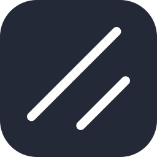
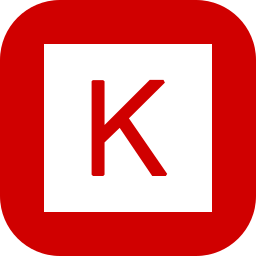

   

<h1 align="center">Hi , I'm Azharangga Kusuma</h1>

### 🎓 About Me  
I’m a Web Developer focused on building responsive web applications and information systems. With a solid foundation in **<u>Computer Science from STMIK IKMI Cirebon</u>**, I have honed my technical skills through **<u>internships, industry-driven projects, and personal initiatives</u>**. While web development remains my primary focus, I actively expand my knowledge into other fields such as Machine Learning, AI, and UI/UX design to deliver more comprehensive and user-centered digital solutions.

- 🛠️ Preferred Stack: Next.js, React.js, Node.js, and modern UI/database tools.
- 📌 Work Style: Crafting interactive, modern, and user-friendly web experiences.
- 🌱 Current Direction: Expanding my knowledge in Web Development, Machine Learning, and UI/UX Design.
- 🤝 Open To: Collaboration on meaningful web products and open-source initiatives.

### 🚀 What I'm Working On  
My latest project is **Job Tracker**, a modern and professional web application specifically designed to help job seekers manage, track, and analyze their entire job application process centrally.

### 🌱 My Learning Journey  

I’m currently focusing on:  
- **Web Development**: Building modern, interactive, and responsive web applications using technologies such as Next.js, React.js, Node.js, and REST APIs.
- **Machine Learning**: Exploring computer vision, natural language processing, and time series forecasting by developing machine learning, deep learning, and artificial intelligence models with TensorFlow, Keras, and Scikit-learn.
- **UI/UX Design**: Designing intuitive user interfaces, wireframes, and high-fidelity prototypes in Figma with a focus on usability, consistency, and modern design principles.

I strive to continuously learn and grow, staying adaptable in the ever-evolving world of technology.  

### 💻 Tech Stack

  
  
  
  
  
  
  
  
  
  
  
  
  
  
  
  
  
  
  
  
  
  

 

### 📊 GitHub Stats  

  
  

  

### 💬 Let’s Connect  
I’m always open to collaboration, freelance opportunities, and discussions about building practical web applications. If you have an idea or project in mind, feel free to reach out.  
 
  

---

  

